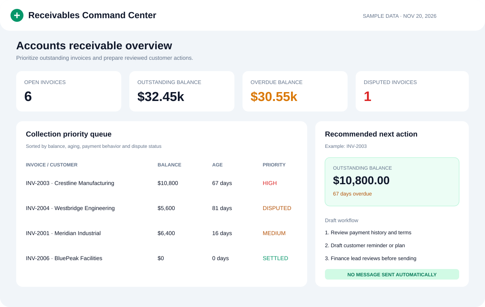
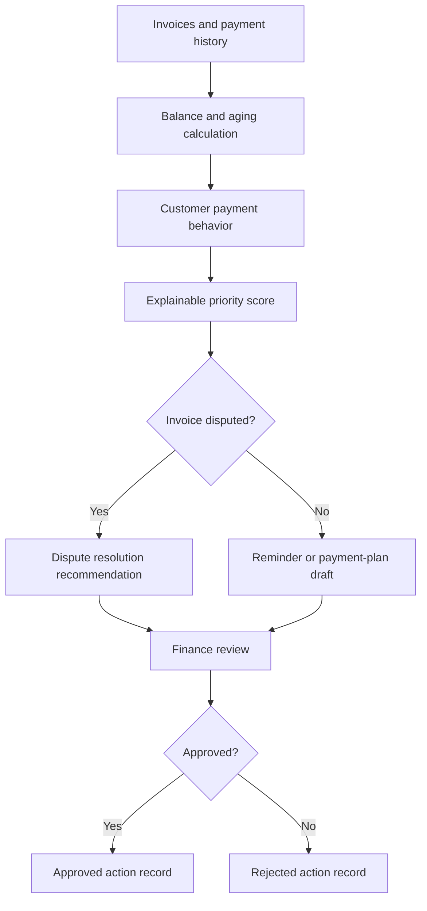

# AI Accounts Receivable & Collections Agent

An explainable accounts-receivable decision-support API for B2B finance teams. It calculates invoice aging and outstanding balances, analyzes historical payment behavior, prioritizes collection work, drafts customer reminders, and proposes installment plans for finance-team review.

> **Demo scope:** Synthetic invoice and payment records with deterministic rules. This is a runnable workflow prototype—not a trained credit-risk model, accounting-system integration, or autonomous collections service.

## Dashboard preview



*Illustrative dashboard concept based on the API's sample invoice data. This repository currently provides a REST API and Swagger UI, not a browser dashboard.*

## Business scenario

A B2B company has invoices at different stages of the payment cycle. Some customers usually pay near the due date, others have a history of late payment, and one invoice is disputed. The finance team needs to prioritize accounts without sending inappropriate reminders or making unsupported promises.

This demo helps answer:
- How much money is outstanding and overdue?
- Which invoices should the team prioritize?
- What payment patterns are visible in the available history?
- Should the next step be a reminder, payment-plan discussion, or dispute resolution?
- Can an action be drafted and reviewed before it is sent?

## Features

- **Invoice aging** with days overdue and buckets (not due, 1–30, 31–60, 61–90, 90+).
- **Outstanding balance calculation** using invoice totals and recorded payments.
- **Explainable collection prioritization** from balance, days overdue, payment behavior, and dispute status.
- **Payment-behavior summary** with average days late and late-payment rate.
- **Context-aware recommendations** that route disputed invoices to dispute resolution instead of ordinary reminders.
- **Personalized reminder drafts** using sample customer contact and invoice details.
- **Installment-plan proposals** based on configurable customer demo settings and minimum installment thresholds.
- **Human approval workflow** for reminder and payment-plan actions.
- FastAPI REST API, Swagger docs, synthetic data, tests, Docker, and Python 3.11/3.12 CI.

## Workflow



## Quick start

Requires Python 3.11+.

```bash
git clone https://github.com/HardikPaghdar/ai-accounts-receivable-collections-agent.git
cd ai-accounts-receivable-collections-agent
python -m venv .venv
source .venv/bin/activate
# Windows: .venv\\Scripts\\Activate.ps1
pip install -e ".[dev]"
uvicorn app.main:app --reload
```

Open http://127.0.0.1:8000/docs for interactive Swagger UI. No external API key is required.

## Try the workflow

**1. Collection priority queue**
```bash
curl http://127.0.0.1:8000/api/collections/priority
```
Returns invoice balance, days overdue, aging bucket, payment behavior, priority score, and factor-level evidence.

**2. Invoice recommendation**
```bash
curl http://127.0.0.1:8000/api/invoices/INV-2003/recommendation
```
Returns an explainable next step. Disputed invoices are routed to dispute resolution.

**3. Create a reminder draft**
```bash
curl -X POST http://127.0.0.1:8000/api/collection-actions \\
  -H "Content-Type: application/json" \\
  -d '{"invoice_id":"INV-2003","action_type":"reminder"}'
```
Returns a draft and `pending_approval` status. It is not emailed or sent.

**4. Propose an installment plan**
```bash
curl -X POST http://127.0.0.1:8000/api/collection-actions \\
  -H "Content-Type: application/json" \\
  -d '{"invoice_id":"INV-2003","action_type":"payment_plan"}'
```
Returns an illustrative schedule based on sample customer settings.

**5. Record finance approval**
```bash
curl -X POST http://127.0.0.1:8000/api/collection-actions/ACTION_ID/decision \\
  -H "Content-Type: application/json" \\
  -d '{"decision":"approved","reviewer":"AR Lead","note":"Reviewed against account terms"}'
```
Decision must be `approved` or `rejected`. A reviewed action cannot be decided again.

## API reference

| Method | Endpoint | Purpose |
|---|---|---|
| GET | `/health` | Health check and demo as-of date |
| GET | `/api/overview` | Invoice, outstanding, overdue, dispute, and priority summary |
| GET | `/api/invoices` | Invoices with calculated aging and balances |
| GET | `/api/collections/priority` | Ranked collection work queue |
| GET | `/api/invoices/{id}/recommendation` | Explainable invoice recommendation |
| POST | `/api/collection-actions` | Create reminder or payment-plan draft |
| GET | `/api/collection-actions` | List in-memory action records |
| POST | `/api/collection-actions/{id}/decision` | Approve or reject a draft |

Full schemas are available at `/docs`.

## Decision logic

The priority score is a weighted heuristic (0–100):

| Signal | Maximum contribution |
|---|---:|
| Outstanding balance | 25 |
| Days overdue | 35 |
| Customer payment behavior | 25 |
| Dispute status | 15 |

Payment behavior uses sample payment records to calculate average days late and the share of payments recorded as late. Recommendation rules distinguish not-yet-due, recently overdue, older overdue, and disputed invoices.

This score prioritizes a work queue; it is not a probability of default, credit decision, or legal collections recommendation. Finance teams should validate the policy and weights before using real account data.

## Project structure

```text
app/main.py                 # API, aging, scoring and approval workflow
data.json                   # Synthetic customers, invoices and payments
docs/architecture.svg       # Workflow architecture
docs/screenshots/            # Illustrative dashboard preview
tests/test_api.py            # API and business-rule tests
.github/workflows/ci.yml    # Python 3.11 / 3.12 CI matrix
pyproject.toml
Dockerfile
.env.example
```

## Tests and Docker

```bash
pytest -q
docker build -t ar-collections-agent .
docker run --rm -p 8000:8000 ar-collections-agent
```

Then open http://127.0.0.1:8000/docs.

## Configuration and sample dates

The demo uses a fixed as-of date of **2026-11-20** in `app/main.py` so aging calculations and tests remain reproducible. `.env.example` is a starter template; the current implementation does not read configuration from environment variables.

## Safety, privacy, and limitations

- All customer, invoice, and payment records are synthetic.
- Prioritization is deterministic and rule-based; no LLM or credit-default prediction is used.
- No accounting/ERP systems, bank feeds, payment gateways, or CRM platforms are connected.
- Reminder text is a draft only; no email, SMS, letter, or legal notice is sent.
- Installment plans are illustrative proposals, not negotiated agreements or changes to customer terms.
- Disputed invoices are flagged for resolution; the demo does not investigate or adjudicate disputes.
- Action state is held in process memory and resets on restart.
- Authentication, authorization, persistent storage, audit-grade history, and production observability are not implemented.

Do not use the sample priority score as the sole basis for credit, legal, or collections decisions.

## Implemented vs. possible extensions

**Implemented:** invoice balance and aging, payment-behavior summaries, explainable prioritization, dispute-aware recommendations, reminder drafts, installment proposals, approval/rejection workflow, REST API, tests, Docker, and CI.

**Possible extensions:** configurable policy engine, PostgreSQL persistence, accounting/ERP integration, payment reconciliation, CRM sync, email provider with approval gates, LLM-assisted tone adaptation, multilingual templates, and audit reporting.

## Related projects

- [AI Invoice Processing Automation](https://github.com/HardikPaghdar/ai-invoice-processing-automation) — invoice extraction, validation, and exception handling.
- [SaaS Subscription Revenue Agent](https://github.com/HardikPaghdar/saas-subscription-revenue-agent) — subscription revenue and failed-payment workflows.
- [HubSpot CRM Migration Automation](https://github.com/HardikPaghdar/hubspot-crm-migration-automation) — CRM data migration and validation.
- [More projects on my portfolio](https://hardikpaghdar.netlify.app/).

## License

MIT — see [LICENSE](LICENSE).
